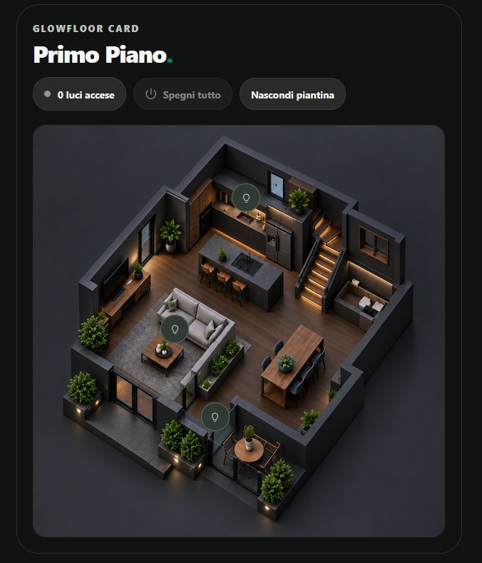

# GlowFloor Card

[](https://www.tiktok.com/@luigi.regolo)
[](https://github.com/luigi-regolo/glowfloor-card/releases/latest)
[](LICENSE)
[](https://my.home-assistant.io/redirect/hacs_repository/?owner=luigi-regolo&repository=glowfloor-card&category=plugin)
[](https://github.com/luigi-regolo/glowfloor-card/stargazers)

## Overview

**GlowFloor Card** is an interactive floorplan card for Home Assistant, designed with a minimalist interface inspired by the Edera Light and Graphite Dark visual styles.

Place discreet light markers directly on a floorplan, control individual lights, and visualize active lighting through soft, customizable glow effects.

The card includes a visual configuration editor, optional scene shortcuts, a live light counter, an all-off action, and responsive layouts for desktop, tablet, and smartphone dashboards.

GlowFloor uses existing Home Assistant entities and services without requiring additional JavaScript libraries, dedicated cloud accounts, subscriptions, or paid APIs.

## Preview



*GlowFloor Card in a Home Assistant dashboard, showing discreet light markers on a custom floorplan. Appearance and available controls depend on the configured entities and settings.*

## Features

- **Interactive floorplan:** Use the built-in sample or select a custom image through Home Assistant.
- **Discreet light markers:** Compact, Edera-inspired light controls with a 28 px default size, adjustable from 26 to 76 px.
- **Touch-friendly controls:** A minimum 44 × 44 px interaction area, independently of the visible marker size.
- **Light states:** Neutral sage-grey markers for inactive lights and soft champagne styling for active lights.
- **Lighting effects:** Optional diffuse illumination following a light's RGB color and brightness when available.
- **Adjustable light area:** Configure the glow spread individually for each light, from 12% to 75%.
- **Contextual labels:** Show light names during interaction by default, with always-visible and always-hidden alternatives.
- **Live light counter:** Display the number of distinct configured lights currently switched on.
- **All-off control:** Turn off configured lights that are currently on.
- **Show/hide floorplan:** Temporarily hide the floorplan without removing its configuration.
- **Optional scenes:** Add up to three Home Assistant scenes with customizable button labels.
- **Visual configuration:** Five organized editor sections, native Home Assistant entity selectors, and touch-based marker positioning.
- **Responsive appearance:** Automatic, Light, and Dark display modes.
- **Configuration compatibility:** Preserve existing marker positions, custom sizes, and other saved settings.

## Installation

### HACS (Recommended)

Install GlowFloor Card directly from the default HACS catalog.

[](https://my.home-assistant.io/redirect/hacs_repository/?owner=luigi-regolo&repository=glowfloor-card&category=plugin)

1. Open **HACS** in Home Assistant.
2. Search for **GlowFloor Card**.
3. Select **GlowFloor Card** from the results.
4. Click **Download** to install the card.
5. Reload your dashboard if necessary.
6. Add **GlowFloor Card** to your dashboard and configure it using the visual editor.

To install a specific release, use **Download** or **Redownload** and select the desired version when available.

### Alternative: Custom repository

If you prefer to add the repository manually:

1. Open **HACS** and select **Custom repositories** from the menu.
2. Enter `https://github.com/luigi-regolo/glowfloor-card`.
3. Select **Dashboard** as the repository type and add it.
4. Find **GlowFloor Card** in HACS and download it.

### Manual installation

1. Download [`dist/glowfloor-card.js`](dist/glowfloor-card.js).
2. Copy the file into `/config/www/` in Home Assistant.
3. Under **Settings → Dashboards → Resources**, add `/local/glowfloor-card.js` as a **JavaScript module**.
4. Reload the dashboard.
5. Add `custom:glowfloor-card` and configure it.

If the `www` directory was newly created, Home Assistant may need a restart before the file becomes available.

## Configuration and Usage

### Visual editor

GlowFloor Card can be configured entirely through the Home Assistant interface without writing YAML.

The editor contains five sections:

| Section | Configuration |
| --- | --- |
| **Piantina (Floorplan)** | Select or upload a floorplan, restore the sample image, and position markers directly on the image. |
| **Luci (Lights)** | Add `light.*` entities, customize their names, and configure individual glow areas and optional marker sizes. |
| **Scene (Scenes)** | Add up to three `scene.*` entities and customize their labels. |
| **Aspetto (Appearance)** | Configure header text, display theme, default marker size, light effects, and label visibility. |
| **Avanzate (Advanced)** | Adjust marker coordinates and configure a floorplan image path manually. |

### Marker configuration

New configurations use a default marker size of **28 px**.

Marker sizes can be adjusted between **26 and 76 px**, globally or for individual lights. The interactive button area remains at least **44 × 44 px**.

Existing configurations retain explicitly saved dimensions and positions. Individual marker sizes override the global setting.

The illuminated area is configured separately and does not change the marker dimensions.

### Optional YAML configuration

The visual editor is recommended. YAML remains available for advanced configuration.

```yaml
type: custom:glowfloor-card
title: Floorplan
eyebrow: ""
subtitle: ""
theme_mode: auto
label_mode: interaction
spill_enabled: true
marker_size: 28
image: /local/floorplans/example.png
lights:
  - entity: light.example_living_room
    name: Living room
    x: 40
    y: 55
    spread: 32
scenes:
  - entity: scene.example_relax
    name: Relax
```

Replace the example entities and image path with valid values from your Home Assistant instance.

Marker coordinates (`x` and `y`) use percentages from 0 to 100. The `spread` value accepts 12–75%, and an optional per-light `size` accepts 26–76 px.

### Card controls

| Interaction | Result |
| --- | --- |
| Tap or click a light marker | Toggle the associated light. |
| Long-press or right-click a marker | Open its Home Assistant entity details. |
| **Spegni tutto** | Turn off configured lights that are currently on. |
| **Nascondi piantina / Mostra piantina** | Temporarily hide or show the floorplan. |
| Select a scene | Activate the associated Home Assistant scene. |

## Compatibility and Requirements

- Home Assistant with support for custom JavaScript dashboard cards.
- Existing `light.*` entities for light control.
- Optional `scene.*` entities for scene shortcuts.
- Home Assistant media access and suitable permissions when selecting or uploading images.
- HACS for repository-based installation, or manual JavaScript module installation.

No specific minimum Home Assistant version has been independently verified.

GlowFloor relies on Home Assistant's existing entities, services, and permissions. It does not introduce telemetry, advertising, or dedicated paid cloud services.

For private floorplans, use images hosted within your Home Assistant instance rather than external image-hosting services.

## Releases

See [GitHub Releases](https://github.com/luigi-regolo/glowfloor-card/releases) for published stable and pre-release versions.

## Copyright & License

Copyright © 2026 luigi-regolo.

Original project created and maintained by **luigi-regolo**.

Licensed under the **GNU General Public License version 3 only (GPL-3.0-only)**. See [LICENSE](LICENSE) for the complete terms.

The software is provided without warranty to the extent permitted by applicable law.
