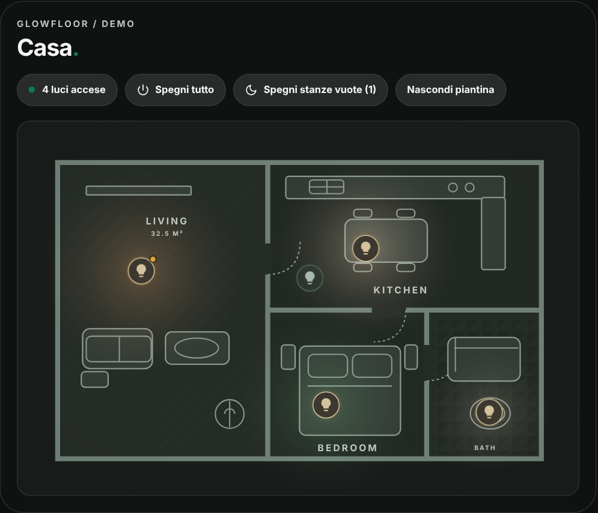
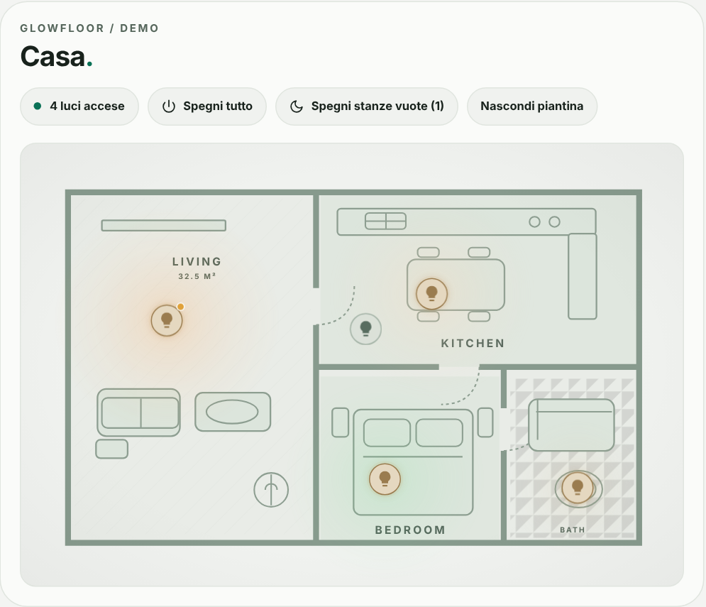
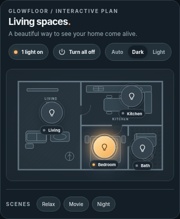

# GlowFloor Card

[](https://www.tiktok.com/@luigi.regolo)
[](https://github.com/luigi-regolo/glowfloor-card/releases/latest)
[](LICENSE)
[](https://my.home-assistant.io/redirect/hacs_repository/?owner=luigi-regolo&repository=glowfloor-card&category=plugin)
[](https://github.com/luigi-regolo/glowfloor-card/stargazers)

## Overview

**GlowFloor Card** is an interactive floorplan card for Home Assistant dashboards. Place circular light controls on a floorplan, switch individual lights on or off, and see a visual glow around lights that are turned on.

Use the included sample floorplan or choose an image from your Home Assistant instance. GlowFloor also supports an on-state counter, an all-off button, up to three optional scenes, and automatic, Light, or Dark appearance.

GlowFloor uses existing Home Assistant entities. It does not create devices or require dedicated cloud accounts, paid APIs, or external JavaScript libraries.

## Preview

| Dark | Light |
| :---: | :---: |
|  |  |

**Mobile preview**



*The images are demonstration previews. Users can configure their own floorplans and entities.*

## Features

- **Interactive light markers:** Circular controls remain visible whether the associated `light.*` entity is on or off.
- **Visual lighting effect:** An optional glow appears around an active marker. Its color follows `rgb_color` when available, and its intensity takes brightness into account when available.
- **Adjustable light area:** A 12–75% slider for each light, independent of marker size.
- **Configurable marker size:** A 32 px default, adjustable to 76 px globally or individually; the interactive target remains at least 44 px.
- **Discreet light labels:** Names appear during interaction by default. Choose always visible or always hidden in the editor.
- **Live counter and all-off:** Count distinct configured lights that are on; turn off only the configured lights that are currently on.
- **Optional scenes:** Up to three `scene.*` shortcuts with editable labels.
- **Custom floorplans:** Select or upload an image through the Home Assistant media selector, or use a local image path.
- **Visual editor:** Five configuration sections, entity search, and marker positioning by tapping the floorplan; YAML is not required.
- **Adaptable appearance:** Optional header texts, automatic/Light/Dark modes, and responsive layouts.

## Installation

### HACS

Install GlowFloor through HACS as a **Dashboard** custom repository.

[](https://my.home-assistant.io/redirect/hacs_repository/?owner=luigi-regolo&repository=glowfloor-card&category=plugin)

1. Open **HACS** in Home Assistant.
2. Open **Custom repositories** from the HACS menu.
3. Enter `https://github.com/luigi-regolo/glowfloor-card`.
4. Select **Dashboard**, then add the repository.
5. Open **GlowFloor Card** in HACS and download it.
6. Edit a dashboard, add **GlowFloor Card**, and configure it using the visual editor.

The button above opens the repository in My Home Assistant; adding and downloading it still require user confirmation.

If the card does not appear after installation, reload Home Assistant in the browser. If necessary, register `/hacsfiles/glowfloor-card/glowfloor-card.js` under your dashboard resources as a **JavaScript module**.

### Manual installation

1. Copy [`dist/glowfloor-card.js`](dist/glowfloor-card.js) into `/config/www/` in your Home Assistant instance.
2. Add `/local/glowfloor-card.js` under **Settings → Dashboards → Resources** as a **JavaScript module**.
3. Reload the dashboard and add `custom:glowfloor-card`.

If the `www` directory is newly created, Home Assistant may require a restart before the file is served.

## Configuration and Usage

### Visual editor

The editor has five sections:

| Section | Settings |
| --- | --- |
| **Piantina (Floorplan)** | Upload or select an image, restore the sample floorplan, and position light markers by tapping the image. |
| **Luci (Lights)** | Select `light.*` entities, edit displayed names, and adjust each light's glow area (12–75%) and optional marker size (32–76 px) under **Altre opzioni**. |
| **Scene** | Add up to three optional `scene.*` entities and customize their button names. |
| **Aspetto (Appearance)** | Set optional header text, color mode, overall marker size, glow effects, and label visibility (`interaction`, `always`, `never`). |
| **Avanzate (Advanced)** | Adjust marker coordinates and provide an image path manually. |

To begin, choose a floorplan, add a light entity, return to **Piantina**, select that light, and tap the desired location. Repeat for additional lights, then save the card. Home Assistant entity IDs must exist in your instance.

### Optional YAML example

```yaml
type: custom:glowfloor-card
title: ""
eyebrow: ""
subtitle: ""
image: /local/floorplans/example.png
theme_mode: auto
label_mode: interaction
spill_enabled: true
marker_size: 32
lights:
  - entity: light.example_living_room
    name: Living room
    x: 40
    y: 55
    spread: 32
scenes:
  - entity: scene.example_relax
    name: Relax
```

Replace example entity IDs and the image path with values from your Home Assistant instance. `x` and `y` are percentages from 0 to 100. `spread` controls the visual light area (12–75%); optional per-light `size` overrides the overall `marker_size` (32–76 px). The visual editor is recommended for normal setup.

### Controls

| Action | Result |
| --- | --- |
| Tap or click a light marker | Toggle the associated light. |
| Long-press or right-click a marker | Open the Home Assistant entity details. |
| **Turn all off** | Turn off configured lights that are currently on. |
| Select a scene | Activate the associated Home Assistant scene. |
| Choose Auto, Dark, or Light on the card | Change the displayed theme temporarily; use the editor to save the configured mode. |

## Compatibility and Requirements

- Home Assistant with support for custom JavaScript dashboard cards.
- At least one existing `light.*` entity to control lights; `scene.*` entities are optional.
- Access to the Home Assistant media selector and suitable permissions for image browsing or upload, if using that method.
- HACS is optional; the card can also be installed manually.

No specific minimum Home Assistant version has been independently verified for this repository. No additional JavaScript dependencies, subscriptions, or dedicated paid APIs are required by GlowFloor.

## Releases

See [GitHub Releases](https://github.com/luigi-regolo/glowfloor-card/releases) for published versions. The initial public release is [`v1.0.0`](https://github.com/luigi-regolo/glowfloor-card/releases/tag/v1.0.0).

## Copyright & License

Copyright © 2026 luigi-regolo.

Original project created and maintained by **luigi-regolo**.

Licensed under the **GNU General Public License version 3 only (GPL-3.0-only)**. See [LICENSE](LICENSE) for the full terms.

The software is provided without warranty to the extent permitted by applicable law.
